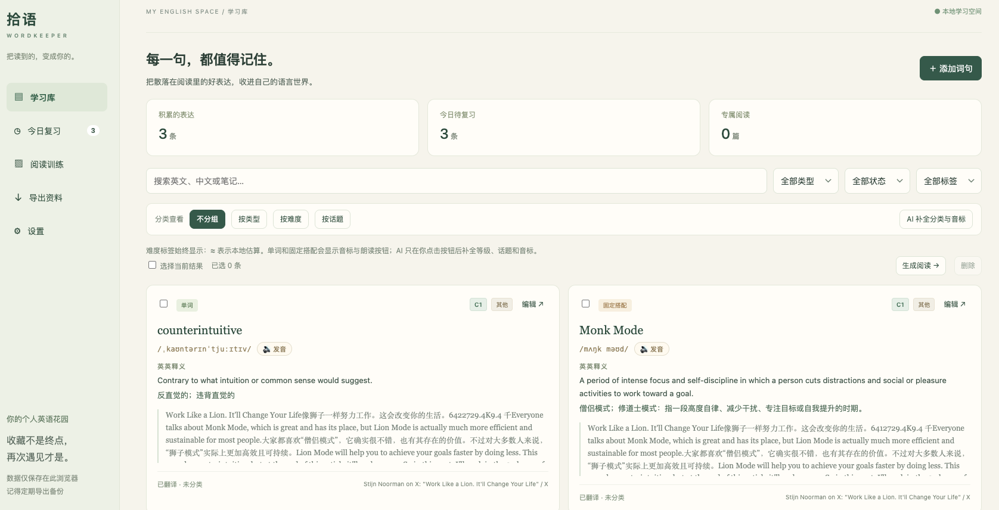
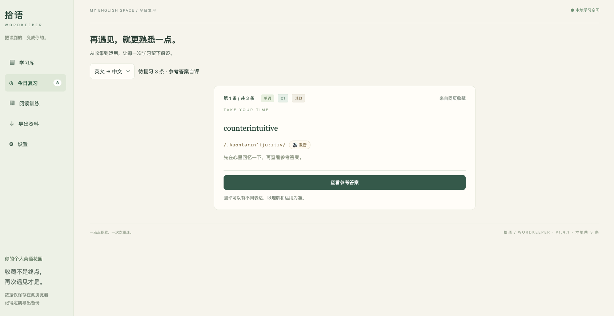
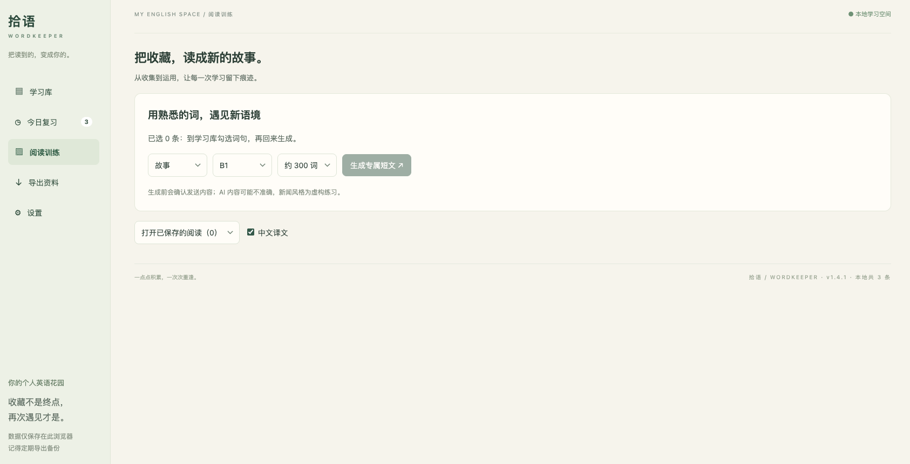
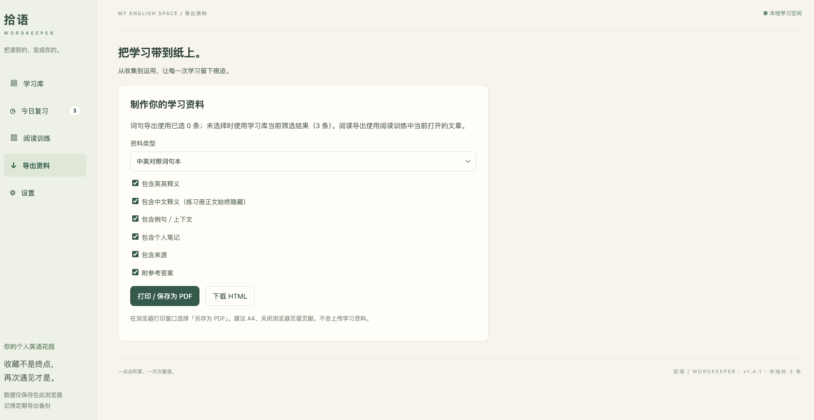

# 拾语 · WordKeeper

> 把读到的，变成你的。

**简体中文** | [English](README.en.md)

一个面向中文英语学习者的 Chrome / Edge 扩展。在网页上选中英文，一次点击即可收藏、翻译并进入复习；之后可以用自己的词句生成阅读材料，或导出成中英对照 PDF。


**English summary:** WordKeeper is a local-first Chrome extension for Chinese learners of English. Select text on any web page to save it, translate it, add IPA and CEFR metadata, review it with spaced repetition, generate short AI-assisted reading passages, and export printable study material.

## 界面预览

| 学习库 | 今日复习 |
| --- | --- |
|  |  |

| 阅读训练 | 导出资料 |
| --- | --- |
|  |  |

## 为什么做这个

阅读英文时，好词好句往往只是“看懂了”，然后被忘记。截图、划线、复制到备忘录都只是收集，缺少复习和再次使用。

拾语把这条链路连起来：

```text
网页选词
  → 本地收藏
  → AI 释义 / 英英解释 / 音标
  → CEFR 难度与话题分类
  → 间隔复习
  → 用这些词生成新文章
  → 导出 PDF / HTML
```

所有学习数据默认保存在浏览器本地；只有用户主动点击翻译、分类或生成文章时，才会把相关内容发送到用户自己配置的 AI 服务。

## 功能

### 网页随时收藏

- 在任意 `http` / `https` 网页选中英文，出现“收藏并翻译”浮动按钮。
- 自动记录原文、上下文、页面标题和来源链接。
- 先写入本地，再异步翻译；翻译失败不会丢失原文。
- 支持右键菜单和手动添加作为降级入口。
- 使用 Shadow DOM 隔离样式，尽量不干扰原网页。
- 清理零宽字符和异常 Unicode，适配 ChatGPT 等富文本页面。

### 释义、音标与发音

- 中文释义
- 英文释义（English definition）
- IPA 音标，例如 `/ˈæpəl/`
- 简短用法与个人笔记
- 浏览器内置英语语音朗读，不依赖额外语音 API

### 分类与难度

用户可以随时切换查看方式：

- 按类型：单词、固定搭配、句子
- 按难度：A1–C2
- 按话题：日常生活、职场工作、科技、旅行等

难度会始终显示在卡片上。未经 AI 分类时使用本地估算并标注 `≈`，不消耗 token。点击“AI 补全分类与音标”后，只处理缺少信息的词条。

### 间隔复习

- 英文 → 中文
- 中文 → 英文
- 上下文填空

先回忆，再查看答案，然后选择“忘记 / 模糊 / 记住”。新收藏的词句会立即进入今日复习。

### AI 阅读训练

从学习库勾选目标词句，生成：

- 故事
- 日常对话
- 科普短文
- 新闻风格练习
- 议论短文

支持 A2–C1、约 150 / 300 / 500 词，生成英文正文、中文译文、目标词高亮、理解题和参考答案。

### 导出与备份

- 中英对照词句本
- 隐藏答案的练习册，答案独立成页
- 阅读训练册
- 浏览器打印预览另存为 PDF
- 导出 HTML 继续编辑
- JSON 备份 / 合并导入，不包含 API Key

## 快速开始

### 环境要求

- Node.js 20+
- npm 10+
- Chrome 或 Edge

### 安装与构建

```bash
git clone <your-repository-url>
cd english-study-extension
npm install
npm run build
```

### 加载扩展

1. 打开 `chrome://extensions` 或 `edge://extensions`
2. 打开“开发者模式”
3. 点击“加载已解压的扩展”
4. 选择项目中的 `dist` 文件夹
5. 打开英文网页，选中文字，点击“收藏并翻译”

浏览器内部页面、部分 PDF 阅读器和受保护页面无法注入浮动按钮，可尝试右键菜单或手动添加。

### 配置 AI

1. 点击扩展图标 → 设置
2. 填写 OpenAI Chat Completions 兼容服务：
   - Base URL，例如 `https://api.openai.com/v1`
   - 模型名称
   - API Key
3. 保存并授权该 API 域名
4. 可选：测试连接

没有配置 API 时仍可收藏、编辑和复习，只是不会自动翻译。

API Key 默认仅保存在当前浏览器会话；选择“在此设备记住密钥”后会写入扩展本地存储。这不是加密保险箱。密钥不会进入备份、网页脚本或同步存储。

## 技术栈

| 领域 | 技术 |
| --- | --- |
| 扩展平台 | Chrome Manifest V3 |
| 前端 | React 19 + TypeScript |
| 构建 | Vite 6 |
| 测试 | Vitest + jsdom + fake-indexeddb |
| 本地存储 | IndexedDB（原生） |
| AI 接口 | OpenAI Chat Completions 兼容 API |
| 导出 | 浏览器打印样式（A4）+ HTML |
| 发音 | Web Speech API |

## 项目结构

```text
.
├── public/
│   └── manifest.json        # Manifest V3 配置
├── src/
│   ├── background.ts        # 右键收藏、自动翻译、AI 消息处理
│   ├── content.ts           # 网页选中文字浮动按钮
│   ├── core.ts              # 数据模型、IndexedDB、AI、分类与复习逻辑
│   ├── export.ts            # PDF / HTML 学习资料生成
│   ├── main.tsx             # 学习库、复习、阅读、导出、设置
│   ├── popup.tsx            # 扩展弹窗
│   └── style.css
├── index.html
├── popup.html
├── vite.config.ts
└── package.json
```

## 测试

```bash
npm test
```

当前测试覆盖：

- IndexedDB 收藏、去重、复习与备份
- AI 请求错误与超时（使用 mock，不发起真实请求）
- 自动收藏翻译成功 / 失败不丢数据
- 浮动按钮状态与失败重试
- HTML / PDF 资料安全转义
- 学习库、复习、阅读、设置与导出界面

构建检查：

```bash
npm run build
```

## 数据与隐私

- 学习数据保存在当前浏览器的 IndexedDB 中。
- 卸载扩展可能删除本地数据，请定期导出 JSON。
- 扩展会请求 `http/https` 页面访问权限，用于在网页选中文字时显示收藏按钮；不会自动读取整页。
- 只有用户主动操作时，才会向配置的 AI 服务发送相关文本。
- 网页摘录和 AI 输出都按不可信文本处理，不作为 HTML 执行。
- API Key 不会写入导出的备份文件。

完整说明见 [PRIVACY.md](PRIVACY.md)。

## 已知限制

- 只能在 Chrome / Edge 开发者模式加载，尚未上架扩展商店。
- 受保护页面和浏览器内部页面无法注入浮动按钮。
- AI 输出可能不准确，新闻风格文章仅用于语言练习。
- 本地难度估算 `≈` 只是学习参考，不等同于正式 CEFR 评定。
- 浏览器语音音色取决于操作系统和浏览器。
- 数据不会跨设备同步。

## Roadmap

- [ ] 打包发布到 Chrome Web Store / Edge Add-ons
- [ ] 更完善的复习统计与学习热力图
- [ ] 支持导入 Anki / CSV
- [ ] 自定义文章模板与难度曲线
- [ ] 可选的云同步
- [ ] 更多界面截图与演示 GIF

## 开发说明

```bash
npm run dev      # 本地预览学习库界面
npm run build    # 类型检查并构建 dist
npm test         # 运行全部测试
```

## 参与贡献

欢迎提交 Issue 或 PR。开发、测试和提交规范见 [CONTRIBUTING.md](CONTRIBUTING.md)。

## License

[MIT](LICENSE) © 2026 WordKeeper Contributors
